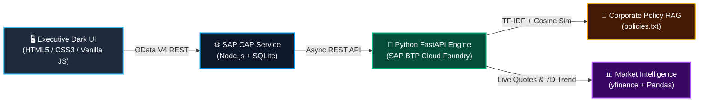

# 🚀 SAP BTP AI Procurement & Market Intelligence Copilot

**An Enterprise Full-Stack AI Copilot built with SAP Cloud Application Programming Model (CAP), Python FastAPI RAG, and Real-Time Market Intelligence — Deployed Live on SAP BTP Cloud Foundry.**

  
  
  
  
  

<h3>
  🔗 <a href="https://sap-ai-procurement-copilot-bogus-badger-sp.cfapps.ap21.hana.ondemand.com" target="_blank">Launch Live Enterprise Dashboard on SAP BTP</a>
</h3>

---

## 📸 Live Application Preview

<!-- IKKADA MEE SCREENSHOT DRAG & DROP / PASTE CHEYYANDI -->

<em>Executive SAP BTP Cockpit displaying Real-Time Market Ticker, 7-Day Price Forecasts, Live OData KPIs, and Automated AI Policy Compliance.</em>

---

## ✨ What We Built — Complete Feature Breakdown

### 1. 🤖 Automated AI Policy Compliance Engine (Zero-Cost RAG)
* Evaluates incoming **Purchase Orders** against corporate procurement rules (`policies.txt`) using **TF-IDF Vectorization & Cosine Similarity** (`scikit-learn`).
* Automatically detects **unapproved/unregistered vendors**, flags low vendor performance ratings (`< 3.0`), and enforces multi-tier financial approval thresholds (`>$5,000` Manager Approval / `>$10,000` VP Approval).
* Returns structured risk scores, compliance verdicts (`Approved` vs. `Flagged`), and actionable audit explanations directly into the SAP CAP database.

### 2. 📈 Real-Time Market & Technology Intelligence (`yfinance`)
* **Live Auto-Refreshing Ticker (60s Cycle):** Streams real-time quotes and 24-hour percentage changes for **Gold (`GC=F`)**, **USD/INR (`INR=X`)**, **Bitcoin (`BTC-USD`)**, **NVIDIA AI (`NVDA`)**, and **SAP SE (`SAP`)**.
* **7-Day Trend & Short-Term Price Forecasting:** Analyzes historical 7-day sessions to compute **Present Live Rate**, **7-Day Moving Average**, **7-Day High/Low Range**, and a **Momentum-Based Short-Term Price Projection** with strategic procurement timing advice.

### 3. 💬 Hybrid Live-DB & Policy Q&A Copilot
* Natural language AI assistant that bridges **transactional SAP CAP OData V4 records** with **unstructured corporate policy documents**.
* Capable of answering live operational queries (*"Show flagged orders"*, *"What is our total procurement spend?"*, *"Which vendors need review?"*) alongside policy compliance rules in a single unified interface.

### 4. ⚙️ Enterprise SAP CAP Backend & OData V4 Services
* Built using **SAP Cloud Application Programming Model (`@sap/cds`)** on Node.js with strongly typed CDS schemas (`Vendors` and `PurchaseOrders`).
* Exposes standard **OData V4 REST endpoints** alongside custom bound/unbound CAP actions for real-time AI inference and live dashboard synchronization.

### 5. 🎨 Executive Dark-Mode Procurement Cockpit
* Custom-engineered responsive enterprise UI built with modern **HTML5, CSS3, and Vanilla JavaScript**.
* Features real-time KPI summary cards (**Total Purchase Orders**, **Approved**, **Pending/Review**, **AI Flagged**), live countdown refresh indicators, one-click AI compliance triggers, and interactive market search.

### 6. ☁️ Multi-Microservice Cloud Foundry Deployment (SAP BTP)
* Architected as two decoupled cloud microservices running live on **SAP BTP Cloud Foundry (`ap21` Singapore Region)**:
  * **Frontend + CAP OData Service:** [`sap-ai-procurement-copilot`](https://sap-ai-procurement-copilot-bogus-badger-sp.cfapps.ap21.hana.ondemand.com)
  * **Python AI & Market Microservice:** [`ai-procurement-engine`](https://ai-procurement-engine-kind-lion-hi.cfapps.ap21.hana.ondemand.com/docs)

---

## 🏗️ System Architecture

---

## 🛠️ Tech Stack

| Layer | Technologies Used | Role in Architecture |
| :--- | :--- | :--- |
| **Cloud Infrastructure** | SAP BTP Trial, Cloud Foundry (`ap21`), BAS | Multi-app cloud runtime, routing & environment management |
| **SAP Backend & API** | SAP CAP (`@sap/cds`), Node.js, OData V4, SQLite | CDS domain modeling, OData services & business logic |
| **AI Microservice** | Python 3.10+, FastAPI, Uvicorn, Pydantic | High-speed REST API for AI compliance & market analytics |
| **NLP & RAG Engine** | Scikit-Learn (`TfidfVectorizer`), Cosine Similarity | Zero-cost semantic policy retrieval & risk scoring |
| **Financial & Market API** | `yfinance`, Pandas, NumPy | Real-time market tickers, 7-day averages & trend models |
| **Frontend Cockpit** | HTML5, CSS3, Modern JavaScript (ES6+) | Responsive executive dashboard with live auto-refresh |

---

## 🗺️ End-to-End Engineering Milestones

| Phase | Milestone | Key Deliverables |
| :---: | :--- | :--- |
| **Phase 1** | **SAP BTP & BAS Setup** | Configured SAP BTP Trial subaccount, Cloud Foundry CLI, and CAP project scaffolding |
| **Phase 2** | **CAP Data Model & OData** | Designed `Vendors` & `PurchaseOrders` CDS entities, CSV seed data, and OData V4
